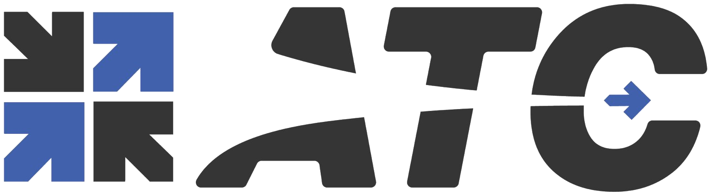

# Copyright Certificate

| | |
|---|---|
| **Work** | ATC Palm Access: palm-vein access control and attendance software |
| **Type of work** | Computer program: source code, object code, documentation, user interface, graphics |
| **Owner** | ATC |
| **First published** | 16 November 2026 |
| **Version** | 1.0.0 |
| **Status** | Proprietary. **All rights reserved.** |
| **Licence** | [ATC Proprietary Software License](LICENSE). Viewing only, no permission to use, copy, modify, build or distribute |

## Statement of ownership

ATC owns all copyright and other intellectual-property rights in this work, including:

- the Flutter/Dart application (`lib/`)
- the Android native integration layer (`android/app/src/**/kotlin`, `android/app/src/**/java`)
- the security design, Keystore crypto layer and backup format
- the documentation (`README.md`, `docs/`, `SECURITY_AUDIT.md`)
- the user-interface designs, screenshots, graphics, logos and the "ATC" and "ATC Palm Access" marks

Under the Berne Convention, copyright protection arises automatically when a work is created; it does not need registration. This certificate and the repository's public commit history together record the date and content of first publication.

## Notice

> © 2026 ATC. All rights reserved. No part of this software may be used, reproduced, modified, built, deployed or distributed in any form or by any means without the prior written permission of ATC. Unauthorised use is copyright infringement and will be pursued, including through DMCA takedown notices.

## Third-party components (not owned by ATC, not included)

| Component | Owner | In this repository? |
|---|---|---|
| VP530 palm-vein SDK (`.aar`) | HFSecurity | No. Licensed separately by the hardware vendor |
| UVC camera library (`lib-eyecool-uvccamera`) | eyecool | No |
| Board API (`libHibory_CommonApi.so`) | Hibory | No |
| Flutter and pub.dev packages | Their respective authors | Referenced in `pubspec.yaml` under their open-source licences |
