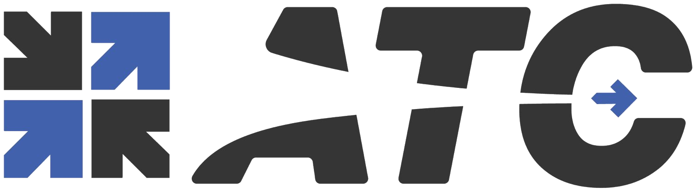
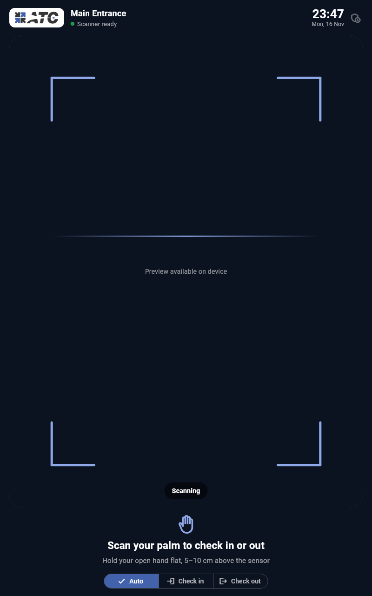
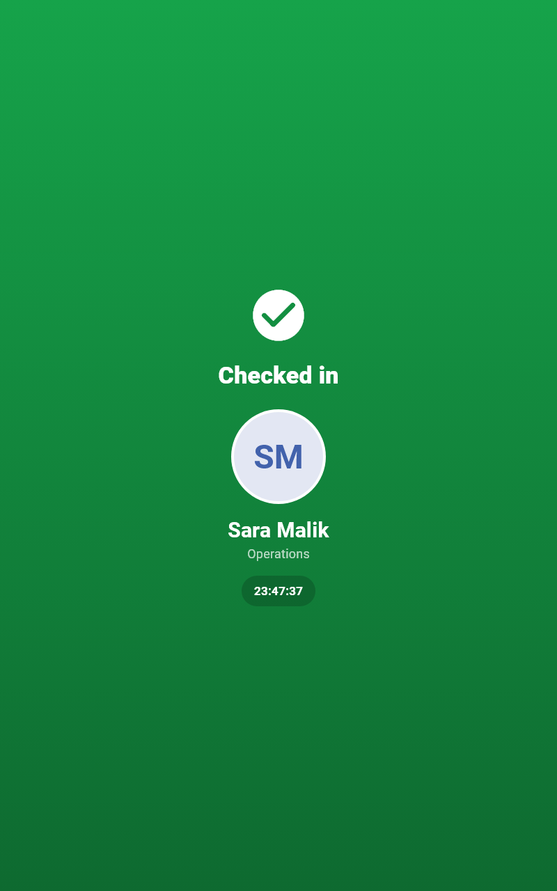
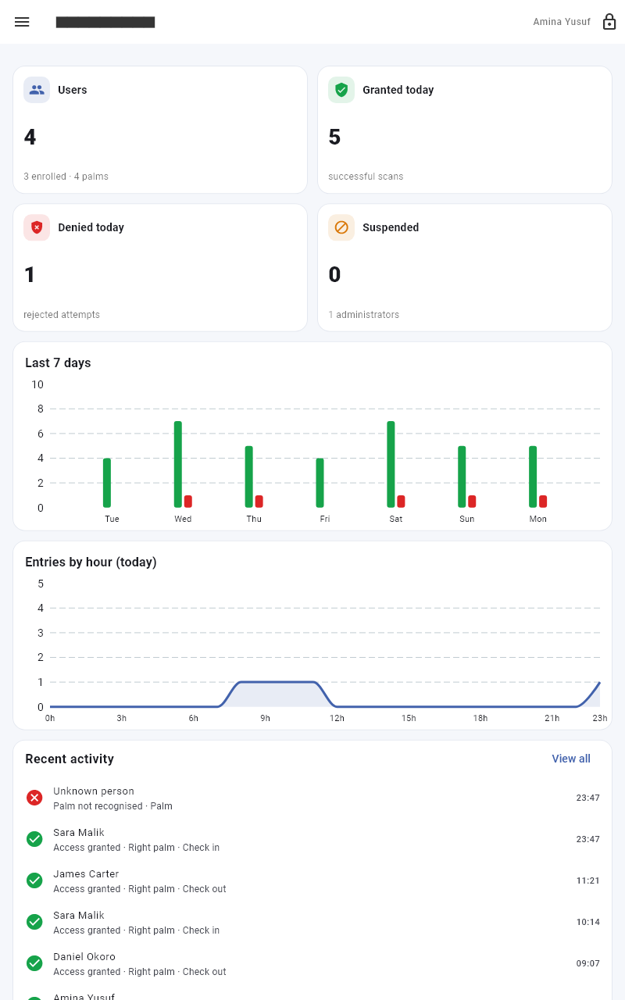
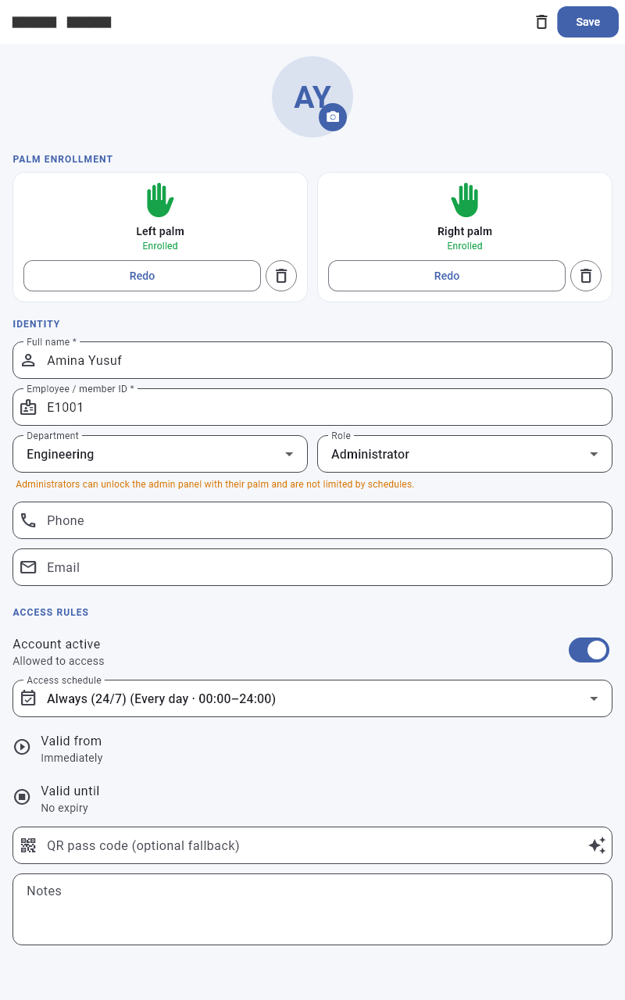
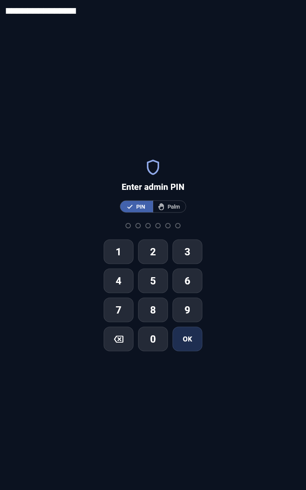
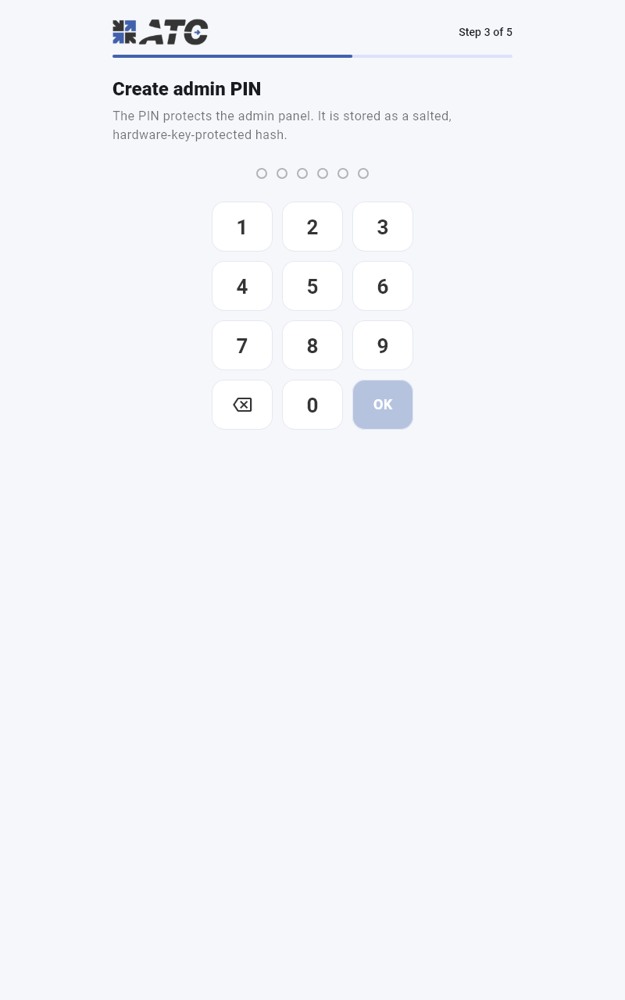

<p align="center">
  
</p>

<h1 align="center">ATC Palm Access</h1>

<p align="center">
  <b>Palm vein biometric access control and time-attendance app for Android terminals.</b><br>
  Contactless palm-vein recognition · door access control · employee attendance · offline and encrypted<br>
  Built with Flutter and Kotlin for HFSecurity VP530 palm scanners and FP08 / MT8768 terminals.
</p>

<p align="center">
  
  
  
  
  
  
</p>

<p align="center">
  <a href="#features">Features</a> ·
  <a href="#screenshots">Screenshots</a> ·
  <a href="#supported-hardware">Hardware</a> ·
  <a href="#security">Security</a> ·
  <a href="#architecture">Architecture</a> ·
  <a href="docs/USER_GUIDE.md">User guide</a> ·
  <a href="SECURITY_AUDIT.md">Security audit</a> ·
  <a href="#license">License</a>
</p>

> **© 2026 ATC. All rights reserved.** This repository is published for **viewing only**. You may not copy, use, build, modify or distribute any part of it. See [LICENSE](LICENSE) and the [Copyright Certificate](COPYRIGHT.md).

---

## What is ATC Palm Access?

**ATC Palm Access** is an Android **palm vein recognition** app that turns a palm-vein terminal into a complete **biometric access control system** and **time and attendance clock**. A person holds an open hand 5–10 cm above the scanner. The near-infrared (IR) camera reads the vein pattern under the skin, matches it on the device in under a second, and grants or denies entry with a green or red screen, the scanner LED, a beep and a voice greeting.

Palm vein authentication is one of the most accurate and hygienic **contactless biometrics**:

- **Nothing to touch.** No fingerprint smudges or wear.
- **Hard to spoof.** The vein pattern is inside the hand, and the scanner checks for a live hand.
- **Stays accurate in practice.** Unlike face recognition, it isn't thrown off by masks, glasses or lighting.

The app is **offline-first**: no cloud and no subscription. All palm templates are **encrypted with a hardware-backed Android Keystore key** and never leave the terminal.

## Features

### Access control
- Contactless **palm vein identification** (1:N) against the on-device template database
- **Left and right palm** enrollment per person, with guided capture and live feedback
- **Access rules:** active or suspended accounts, valid-from/valid-until dates (visitors, contractors), weekly **time schedules** including overnight shifts
- Repeat-scan suppression, so a double scan isn't logged twice and the door still opens
- Optional **QR code pass** fallback via the RGB camera
- Instant feedback: full-screen result, **green/red LED**, beep, **text-to-speech greeting**, user photo
- Privacy mode that shows only first names to bystanders

### Time and attendance
- **Check-in / check-out** with automatic or manual direction
- **Attendance report:** first in, last out and hours worked per person per day, filterable by department
- **CSV export** for payroll and HR systems

### Administration
- **Dashboard:** total users, enrolled palms, granted and denied today, people present now, 7-day and hourly charts
- **User management:** photo, employee ID, department, role (Administrator, Employee, Visitor, Contractor), phone, email, notes
- **Searchable access log** with date-range and result filters
- **Departments and access schedules**
- **Audit trail** of every administrative action
- **Scanner diagnostics:** live status, template sync check, palm-library rebuild, **3-step sensor calibration**, LED test, USB camera selection, rotation and mirroring

### Integration and data
- **Webhooks:** signed (HMAC-SHA256) HTTPS JSON events for door controllers, HR/ERP, SIEM or Slack bridges
- **Encrypted backup and restore** (AES-256-GCM, password-based) to move users and palm templates to a new terminal without re-enrolling
- Configurable **data retention** and factory reset

### Kiosk / dedicated-device mode
- **Screen pinning** (lock task), **set as home app**, **start on boot**, always-on screen
- Portrait-locked, distraction-free terminal UI in the ATC brand style

## Screenshots

| Terminal: scanning | Terminal: access granted | Admin dashboard |
|---|---|---|
|  |  |  |

| User and palm enrollment | Admin login (PIN or palm) | First-run setup |
|---|---|---|
|  |  |  |

## Supported hardware

| Device / module | Chipset | Build flavor | Notes |
|---|---|---|---|
| **HFSecurity VP530** palm-vein module (IR `0x1D6C:0x0103`, `0x0507:0x0581`; RGB `0x2C7F:0x4A60`) | any | all | USB UVC IR camera + LED controller |
| **FP08** palm-vein terminal (built-in VP530) | MediaTek **MT8768 / MT6765**, Android 13 | `mtk` | App powers the built-in scanner automatically ([details](docs/HARDWARE.md)) |
| Other MediaTek terminals | MTK | `mtk` | |
| Rockchip RK3288 / RK3399 / RK33xx terminals | Rockchip | `r3xxx` | No LED/calibration API in that SDK |
| Rockchip RK3566 / RK3568 terminals | Rockchip | `r356x` | Android 9+ |

Screen: portrait 800×1280 recommended; landscape layouts are supported.

## Security

Security was designed in from the start and **independently audited**. Full report: **[SECURITY_AUDIT.md](SECURITY_AUDIT.md)**.

- **Biometric templates** encrypted at rest with **AES-256-GCM** using a non-exportable, hardware-backed **Android Keystore** key
- **Admin PIN:** PBKDF2-HMAC-SHA256 (120k iterations) over a Keystore-held **pepper**, so a stolen database can't be brute-forced offline; escalating lockout; inactivity auto-lock
- **No cloud:** vendor cloud matching disabled; templates never leave the device
- **No cleartext network traffic** except the vendor's licence host; **HTTPS-only** webhooks with HMAC signatures
- **No Android backup** of biometric data (`allowBackup=false`, data-extraction rules)
- `FLAG_SECURE` blocks screenshots and screen recording of personal data
- CSV formula-injection protection, parameterised SQL, R8 minification, Dart obfuscation
- Complete **audit trail** of administrative actions

Report vulnerabilities privately; see [SECURITY.md](SECURITY.md).

## Architecture

```
┌────────────────────────── Flutter / Dart (UI + business logic) ──────────────────────────┐
│ Kiosk terminal · Enrollment · Admin (dashboard, users, logs, attendance, settings, audit)│
│ AccessEngine (rules, schedules) · AuthService (PIN/palm) · Backup · Webhooks · SQLite    │
└───────────────▲──────────── MethodChannel / EventChannel / PlatformView ────────────────┘
                │
┌───────────────┴──────────────── Android native (Kotlin) ─────────────────────────────────┐
│ PalmEngine: VP530 SDK init/retry, 1:N recognition, enrollment, template library,         │
│             calibration, QR decoding (ZXing)                                             │
│ UvcCamera: USB IR/RGB camera + LED controller │ PalmPreviewView: rotated live preview    │
│ SecureVault: Android Keystore AES-GCM, PIN pepper, backup crypto                         │
│ PalmExtras: chipset-specific (MTK LED/calibration, FP08 scanner power switch)            │
└───────────────▲──────────────────────────────────────────────────────────────────────────┘
                │ vendor SDK (not included)
        HFSecurity VP530 palm-vein SDK · eyecool UVC · Hibory board API
```

More detail in **[docs/ARCHITECTURE.md](docs/ARCHITECTURE.md)**.

### Tech stack
Flutter 3.44 · Dart 3.12 · Kotlin · Android Gradle Plugin 9 · SQLite (sqflite) · Android Keystore · ZXing · fl_chart · flutter_tts · Material 3. All dependencies are free and open source; there are no paid services.

## Documentation

| Document | Contents |
|---|---|
| [docs/USER_GUIDE.md](docs/USER_GUIDE.md) | Installation, first-run setup, enrollment, daily use, kiosk mode, backup, troubleshooting |
| [docs/ARCHITECTURE.md](docs/ARCHITECTURE.md) | Modules, data model, native bridge API, event flow |
| [docs/HARDWARE.md](docs/HARDWARE.md) | VP530 module, FP08 terminal USB power switch, chipset flavors |
| [SECURITY_AUDIT.md](SECURITY_AUDIT.md) | Security review, findings and controls |
| [CHANGELOG.md](CHANGELOG.md) | Release history |

## Building

This repository is **not buildable by third parties**. It intentionally excludes the proprietary vendor SDK binaries and ATC's signing keys, and the [LICENSE](LICENSE) forbids building or running it. Authorised ATC developers should follow the internal build notes in [docs/ARCHITECTURE.md](docs/ARCHITECTURE.md#building-authorised-developers-only).

## FAQ

**What is palm vein recognition?**
A biometric method that photographs the vein pattern inside the palm with near-infrared light. It is unique per person and per hand, stable over a lifetime, and very hard to forge.

**Does it work offline?**
Yes. Matching, logs and reports all run on the terminal. Internet is only needed once to activate the scanner licence, and optionally for webhooks.

**How many users does it support?**
Thousands of palm templates on-device. 1:N identification runs locally in well under a second.

**Can it open a door?**
Yes, through the signed webhook to a network door controller. On supported boards, Wiegand and relay outputs are planned.

**Is it GDPR / biometric-privacy friendly?**
Templates are encrypted on the device and never sent to a cloud. Retention is configurable, and every admin action is audited. You still need employee consent and a privacy policy.

## License

**Proprietary: © 2026 ATC. All rights reserved.**
Viewing on GitHub is allowed. Using, copying, modifying, building, deploying or distributing is **not** allowed without written permission. See [LICENSE](LICENSE) and [COPYRIGHT.md](COPYRIGHT.md).

---

<sub>
Keywords: palm vein recognition, palm vein scanner, palm vein access control, palm vein authentication, palm biometric, palmprint, contactless biometric, biometric access control system, biometric attendance system, time and attendance, employee attendance app, door access control, access control app, attendance machine, biometric terminal, Android biometric SDK, VP530, HFSecurity, HFSecurity VP530 SDK, FP08 terminal, MT8768, MediaTek, Rockchip RK3568, RK3566, palm vein Android app, Flutter biometric app, Flutter access control, Kotlin, infrared vein scanner, IR camera UVC, liveness detection, kiosk app, visitor management, workforce management, secure biometric template encryption, Android Keystore, GDPR biometric, ATC, ATC Palm Access.
</sub>
